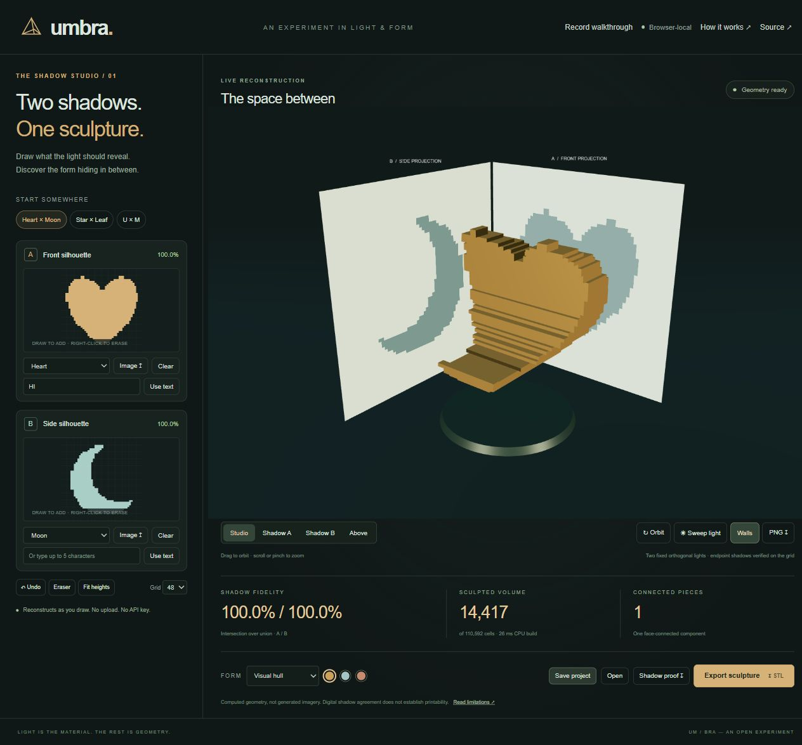

# Umbra

**Two shadows. One sculpture.** Draw two silhouettes, reconstruct their shared 3D volume, verify the projections, and export the actual geometry.

Built for the **General Track of Arbiter Hacks V1**, starting November 1, 2026, with AI assistance. This is an inverse-geometry tool, not an AI image generator. It does not require an account, API credential, camera, or paid service to run locally.



## Run

Requires Node.js 22.12+ and a WebGL-capable browser.

```sh
npm ci
npm run dev
```

Open the Local URL printed by Vite (normally `http://127.0.0.1:4192`). For a static build:

```sh
npm run check
npm run build
```

Serve `dist/` from any static HTTP server. There are no runtime CDN imports, remote fonts, analytics, external model calls or server-side storage. Dependency installation needs npm registry access; an already built copy needs only a static server.

## Use

1. Start with Heart × Moon, Star × Leaf, or U × M.
2. Draw on either target. Use Eraser or right-click to remove pixels. On narrow screens, scroll below the 3D studio to reach the target editor.
3. Replace a silhouette with up to five text characters or import a PNG/JPEG/WebP. Imported images use dark regions as foreground and are fitted to the grid.
4. Inspect the real-time shadows. Studio, endpoint views, above, light sweep, material colors and orbit change the presentation, not the input masks.
5. Red pixels indicate target pixels absent from the reconstructed projection. Fit heights or explicitly add missing row support. The latter changes the requested target and reports exactly how many pixels it adds.
6. Compare Visual hull with Reduced material. Reduction preserves the same endpoint projections, but may create many disconnected pieces.
7. Export STL geometry, editable JSON, the stage PNG, or an SVG shadow proof. Save project is the portable backup; local browser storage is only a convenience.

`Record walkthrough` creates a 150-second WebM demonstration using the actual running renderer and reconstruction pipeline. It is explicitly an automated tour. Keep the tab visible while recording. It needs MediaRecorder/WebM support; failure is reported. It does not record your microphone or desktop.

## The algorithm

For binary row-major target masks A(x,y) and B(z,y), the orthogonal visual hull is:

```text
V(x,y,z) = A(x,y) AND B(z,y)
```

This is the maximal grid volume consistent with both targets. A row can be reproduced exactly if and only if both masks agree about whether that row contains any foreground. For every occupied voxel, forward projection marks its front and side target cells. Intersection over union is computed independently for both targets. The empty/empty convention is 100% IoU, while the interface separately reports an empty intersection and disables STL export.

Reduced mode constructs an edge cover between the occupied x and z samples within each row: every sample on each side is represented by at least one retained voxel. It therefore preserves both binary endpoint projections. It does **not** solve a connected-minimum-material optimization problem.

Boundary meshing emits two triangles for each exposed voxel face, with outward normals. Face-connected components are counted independently. The live Three.js stage uses real shadow maps; these can differ slightly at boundaries from exact binary projections because of bias, filtering and rasterization.

## Architecture

| Module | Responsibility |
| --- | --- |
| `src/geometry.mjs` | Pure reconstruction, forward projection, IoU, conflict repair, material reduction, components, surface mesh, STL, project validation |
| `src/masks.mjs` | Canvas rasterization, shapes, text, height fitting, mismatch display |
| `src/world.mjs` | Three.js scene, two directional lights, camera controls, shadow maps, image capture |
| `src/app.mjs` | Editor, undo, imports/exports, local persistence, error states |
| `src/tour.mjs` | Explicit automated walkthrough composed from live rendering and computed masks |
| `test/geometry.test.mjs` | Mathematical and geometry invariants |

See [validation](docs/VALIDATION.md), [prior art](docs/RESEARCH.md), and [limitations](docs/LIMITATIONS.md).

## Honest limits

- Orthogonal binary silhouettes only. This version does not infer arbitrary 3D objects, use natural language, or recover real-world scale.
- A valid shadow pair need not yield a useful physical sculpture. Neither mode guarantees connectivity, watertightness in degenerate configurations, support, minimum thickness, balance or structural strength.
- STL spans four arbitrary coordinate units. Inspect and scale it in a fabrication tool. No physical fabrication has been validated.
- Shapes are voxelized; finer grids cost more memory and processing. The UI offers 32/48/64. Imported projects are validated within 4–96.
- Image thresholding is deterministic, not semantic segmentation or AI. Presets are explicitly example input shapes.
- Desktop Chrome was tested. Responsive viewport checks do not establish actual iPhone hardware compatibility.
- No user study, adoption metric, or competitive superiority claim has been established.

## Provenance

Visual hulls and computational shadow art are established. This implementation explores a compact, local-first draw → reconstruct → verify → export experience. Prior concepts were brainstormed with AI; this is a fresh implementation of Umbra. Three.js and Vite are dependencies; their exact pinned versions were reused from an existing local dependency installation after sandbox DNS prevented a fresh install. No old application source was copied. AI assistance contributed code, tests, design, documentation and demonstration preparation. See [third-party notices](THIRD_PARTY.md).

MIT licensed. See [LICENSE](LICENSE).
